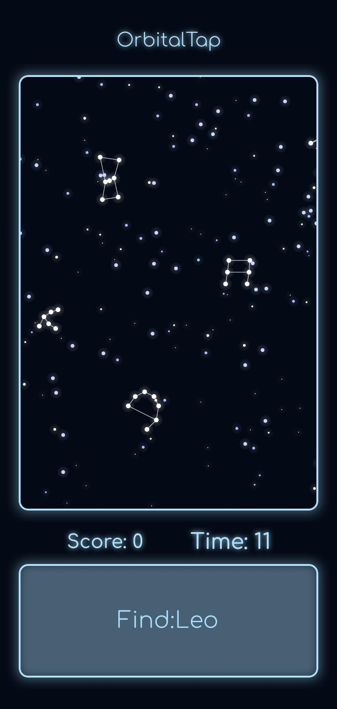

# OrbitalTap

A Kotlin Multiplatform star-map quiz game. You're given a constellation name, and you have to find it on a draggable night sky and tap it before the timer runs out.

Built with Compose Multiplatform for Android and iOS, with all UI and game logic in shared code.


## How to play

1. Press **Start** on the menu.
2. A prompt appears, e.g. `Find: Orion`.
3. Drag the star map to explore the sky (2000 × 2000 map) and tap the constellation.
4. Timer rules:
   - Start with **15 seconds**
   - Correct tap: **+1 score, +5 seconds**
   - Wrong tap: **−3 seconds**
5. When time runs out you see your score and your saved high score. You can restart, return to the menu, or reset the high score.

A tap counts as correct if it lands within 60 px of the constellation's center.

## Constellations

Orion, Taurus, Cygnus, Aquila, Cassiopeia, Ursa Major, Ursa Minor, Leo, Scorpius, Gemini

## Tech stack

| | |
|---|---|
| Language | Kotlin 2.3.21 |
| UI | Compose Multiplatform 1.11.0 (Material 3) |
| Targets | Android (minSdk 24, compileSdk 36) and iOS (arm64 + simulator) |
| Persistence | [multiplatform-settings](https://github.com/russhwolf/multiplatform-settings) 1.3.0 (high score) |
| Build | Gradle with version catalog, AGP 9.2.1 |

## Project structure

```
OrbitalTap/
├── androidApp/            # Android entry point (MainActivity, manifest, icons)
├── iosApp/                # iOS entry point (Xcode project, SwiftUI wrapper)
└── shared/                # Shared Kotlin Multiplatform module
    └── src/commonMain/kotlin/org/nihal/orbitaltap/
        ├── App.kt                  # Root composable and screen switching
        ├── Data/Constellation.kt   # Star and constellation data
        ├── States/GameState.kt     # Score, timer, question, tap and drag logic
        ├── Screens/                # MenuScreen, GameScreen, GameOverScreen
        ├── Theme/Theme.kt          # Glow text, glow box and button styles
        └── Utils/
            ├── StarMapRenderer.kt  # Canvas star map, drag and tap handling
            ├── ValueStorage.kt     # High score storage
            └── Timer/              # Countdown timer and its Compose driver
```

## Getting started

### Prerequisites

- Android Studio (latest stable) with the Kotlin Multiplatform plugin
- JDK 11 or newer (the Gradle daemon toolchain is configured in `gradle/gradle-daemon-jvm.properties`)
- For iOS: macOS with Xcode

### Android

```bash
git clone https://github.com/nihalnijuv496-wq/StarMap-Quiz.git
cd StarMap-Quiz
./gradlew :androidApp:installDebug
```

Or open the project in Android Studio and run the `androidApp` configuration.

### iOS

Open `iosApp/iosApp.xcodeproj` in Xcode and run on a simulator or device, or use the iOS run configuration in Android Studio.

### Tests

```bash
./gradlew :shared:allTests
```

## Adding a constellation

1. Add a `Constellation` entry to the `constellations` list in `Data/Constellation.kt`. Star coordinates are offsets from `center`, and `lines` are pairs of star indices to connect.
2. Add a matching `Pair(name, name)` to `questionAnswerPairs` in `States/GameState.kt`.

## Roadmap

- Replace placeholder `fact` text with real constellation facts
- More constellations

## Credits

- Menu background: *Orion Sky* by Simon Godfrey
- Fonts: Comfortaa, Roboto Condensed, Cedarville Cursive
